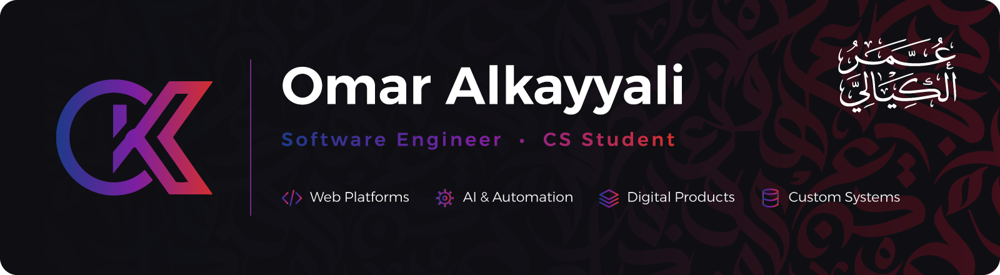
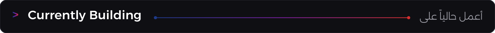
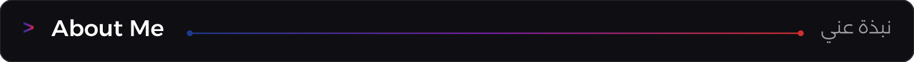
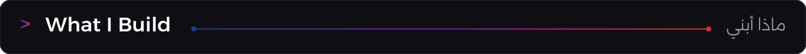
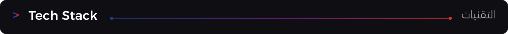
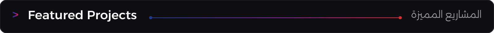
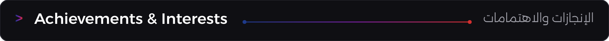
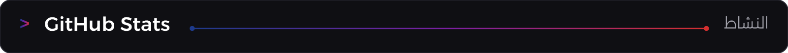
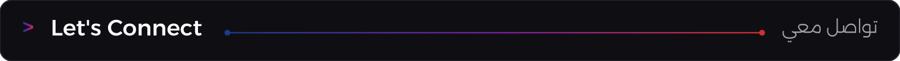

<!-- ═══════════════════════════════ HEADER ═══════════════════════════════ -->
<p align="center">
  
</p>

<p align="center">
  <a href="https://www.omaralkayyali.com/links">
    
  </a>
</p>

<p align="center">
  <a href="https://www.omaralkayyali.com/links"></a>
  <a href="https://www.linkedin.com/in/omaralkayyali"></a>
  <a href="mailto:omaralkayyali.m@gmail.com"></a>
</p>

<p align="center">
  
  <a href="https://github.com/omaralkayyali?tab=followers"></a>
  
</p>

<!-- ═══════════════════════════ CURRENTLY BUILDING ═══════════════════════════ -->


<table width="100%">
  <tr>
    <td align="center" width="25%">📚<br /><b>Safha Platform</b><br /><sub>منصة صفحة</sub></td>
    <td align="center" width="25%">🎬<br /><b>Media Team CMS</b><br /><sub>نظام إدارة محتوى الفريق الإعلامي</sub></td>
    <td align="center" width="25%">🤖<br /><b>AI Automation</b><br /><sub>أتمتة مهام الذكاء الاصطناعي</sub></td>
    <td align="center" width="25%">🎨<br /><b>Digital Products</b><br /><sub>منتجات رقمية</sub></td>
  </tr>
</table>

<!-- ═══════════════════════════════ ABOUT ═══════════════════════════════ -->


<table width="100%">
  <tr>
    <td width="50%" valign="top">
      Computer Science student and software engineering enthusiast. Passionate about <b>AI and automation</b>, building digital products that solve real-world problems. Experienced in <b>technical team leadership</b> and scout volunteering.
    </td>
    <td width="50%" valign="top" dir="rtl" align="right">
      طالب علم حاسوب وشغوف بتطوير البرمجيات. مهتم بمجالات <b>الذكاء الاصطناعي والأتمتة</b>، وأعمل على بناء منتجات رقمية تلبي احتياجات حقيقية. أمتلك خبرة في <b>قيادة الفرق التقنية</b> والعمل التطوعي والكشفي.
    </td>
  </tr>
</table>

```ts
const omar = {
  role:      "Software Engineer • CS Student",
  location:  "Jordan 🇯🇴",
  focus:     ["Web Platforms", "AI & Automation", "Digital Products", "Custom Systems"],
  building:  ["Safha Platform", "Media Team CMS", "AI Automation Workflows"],
  motto:     "Building useful software, one commit at a time.",
};
```

<!-- ════════════════════════════ WHAT I BUILD ════════════════════════════ -->


<table width="100%">
  <tr>
    <td align="center" width="20%">🌐<br /><b>Web Platforms</b><br /><sub>Next.js, full-stack products</sub></td>
    <td align="center" width="20%">🧱<br /><b>Web Applications</b><br /><sub>CMS & internal tooling</sub></td>
    <td align="center" width="20%">🤖<br /><b>AI & Automation</b><br /><sub>n8n workflows, OpenAI APIs</sub></td>
    <td align="center" width="20%">🎨<br /><b>Digital Products</b><br /><sub>Templates & design systems</sub></td>
    <td align="center" width="20%">🛠️<br /><b>Custom Systems</b><br /><sub>Community & leadership platforms</sub></td>
  </tr>
</table>

<!-- ═════════════════════════════ TECH STACK ═════════════════════════════ -->


<table width="100%">
  <tr>
    <td width="50%" align="center">
      <b>Languages</b><br /><br />
      
    </td>
    <td width="50%" align="center">
      <b>Frontend</b><br /><br />
      
    </td>
  </tr>
  <tr>
    <td width="50%" align="center">
      <b>Backend & Cloud</b><br /><br />
      
    </td>
    <td width="50%" align="center">
      <b>AI & Automation</b><br /><br />
      
      
    </td>
  </tr>
  <tr>
    <td colspan="2" align="center">
      <b>Design & Tools</b><br /><br />
      
      
    </td>
  </tr>
</table>

<!-- ══════════════════════════ FEATURED PROJECTS ══════════════════════════ -->


<table width="100%">
  <tr>
    <td width="50%" valign="top" align="center">
      <h3>📚 Safha Platform</h3>
      <p>Library platform</p>
      
      
      <br /><br />
      <sub><b>Role:</b> Full-Stack Developer</sub>
    </td>
    <td width="50%" valign="top" align="center">
      <h3>🎬 Media Team CMS</h3>
      <p>Content management system</p>
      
      
      <br /><br />
      <sub><b>Role:</b> Full-Stack Developer & Team Lead</sub>
    </td>
  </tr>
  <tr>
    <td width="50%" valign="top" align="center">
      <h3>🎨 Sublimation Templates</h3>
      <p>Digital templates library</p>
      
      
      <br /><br />
      <sub><b>Role:</b> Product Designer & Developer</sub>
    </td>
    <td width="50%" valign="top" align="center">
      <h3>⚜️ Scout Corner</h3>
      <p>Scout leadership portal</p>
      
      
      <br /><br />
      <sub><b>Role:</b> Founder & Lead Developer</sub>
    </td>
  </tr>
</table>

<details>
<summary><b>🗂️ Other repositories</b></summary>
<br />

| Repository | Description |
|:--|:--|
| [Google-Workspace-Automation](https://github.com/omaralkayyali/Google-Workspace-Automation) | Business operations automation & Google Apps Script solutions |
| [University-Work](https://github.com/omaralkayyali/University-Work) | University coursework, labs and academic projects |
| [MurshidBagBot](https://github.com/omaralkayyali/MurshidBagBot) | Bot project |

</details>

<!-- ═══════════════════════ ACHIEVEMENTS & INTERESTS ═══════════════════════ -->


<table width="100%">
  <tr>
    <td width="50%" valign="top">
      🎓 Academic journey in <b>Computer Science</b><br />
      🤖 Specialized training in <b>Robotics</b><br />
      ⚜️ <b>Scout Leadership</b> & community volunteering<br />
      🚀 <b>Digital Entrepreneurship</b> & product development<br />
      💡 Innovative <b>AI & Automation</b> projects
    </td>
    <td width="50%" valign="top" dir="rtl" align="right">
      🎓 رحلة أكاديمية في <b>علم الحاسوب</b><br />
      🤖 تدريب متخصص في مجال <b>الروبوتات</b><br />
      ⚜️ <b>قيادة كشفية</b> ومبادرات تطوعية<br />
      🚀 <b>ريادة أعمال رقمية</b> وتطوير منتجات<br />
      💡 مشاريع مبتكرة في <b>الذكاء الاصطناعي</b>
    </td>
  </tr>
</table>

<!-- ════════════════════════════ GITHUB STATS ════════════════════════════ -->


<p align="center">
  
</p>

<table width="100%">
  <tr>
    <td width="50%" align="center">
      
    </td>
    <td width="50%" align="center">
      
    </td>
  </tr>
</table>

<p align="center">
  
</p>

<details open>
<summary><b>📈 Contribution activity</b></summary>
<br />
<p align="center">
  
</p>
</details>

<p align="center">
  <picture>
    <source media="(prefers-color-scheme: dark)" srcset="https://raw.githubusercontent.com/omaralkayyali/omaralkayyali/output/github-snake-dark.svg" />
    <source media="(prefers-color-scheme: light)" srcset="https://raw.githubusercontent.com/omaralkayyali/omaralkayyali/output/github-snake.svg" />
    
  </picture>
</p>

<!-- ════════════════════════════ LET'S CONNECT ════════════════════════════ -->


<p align="center">
  Have an idea or a project in mind? Let's build it together. 🚀<br />
  <sub>عندك فكرة أو مشروع؟ خلّينا نبنيه سوا.</sub>
</p>

<p align="center">
  <a href="https://www.omaralkayyali.com/links"></a>
  <a href="https://www.linkedin.com/in/omaralkayyali"></a>
  <a href="mailto:omaralkayyali.m@gmail.com"></a>
  <a href="https://github.com/omaralkayyali"></a>
</p>

<p align="center">
  
</p>
